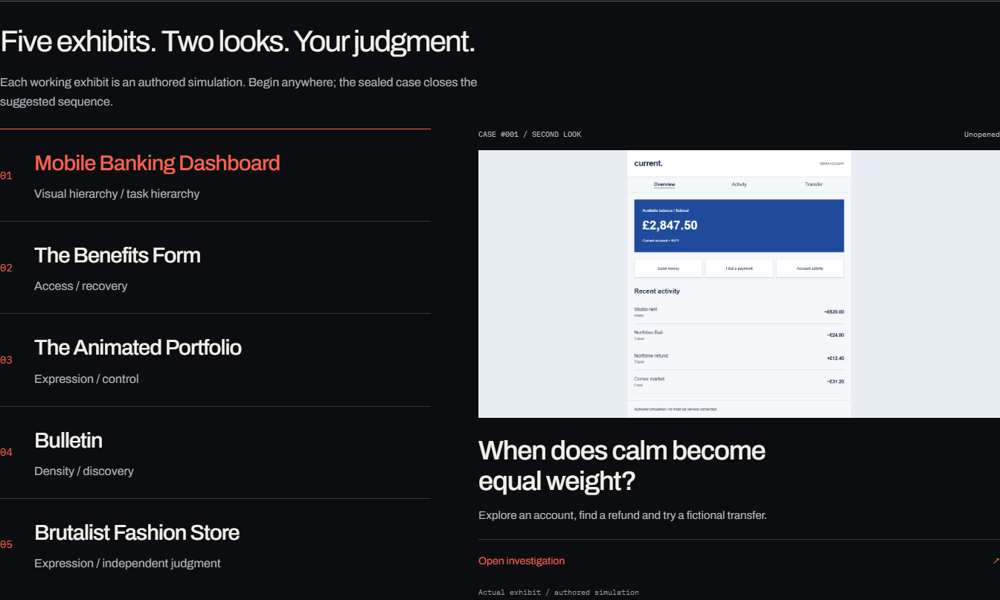
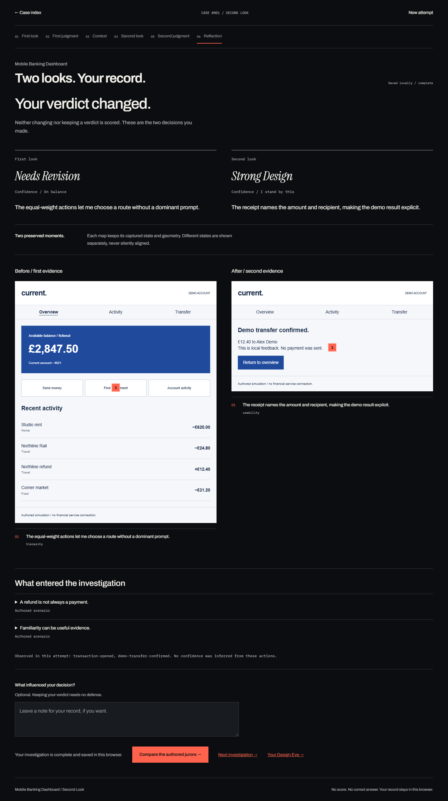
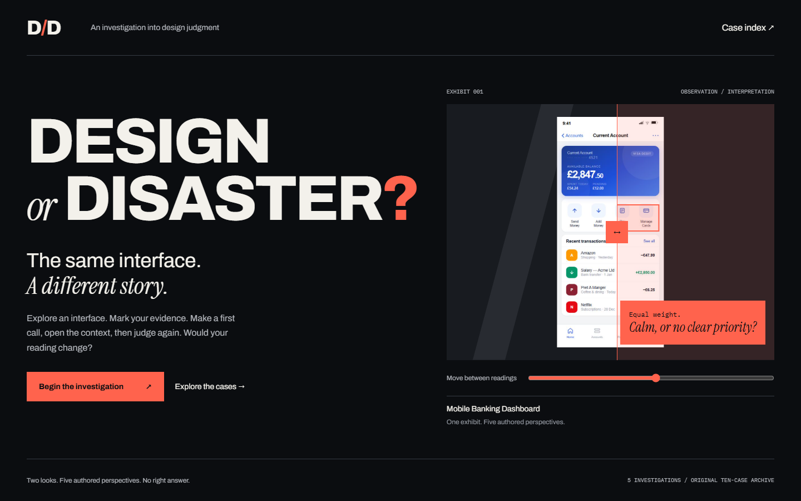
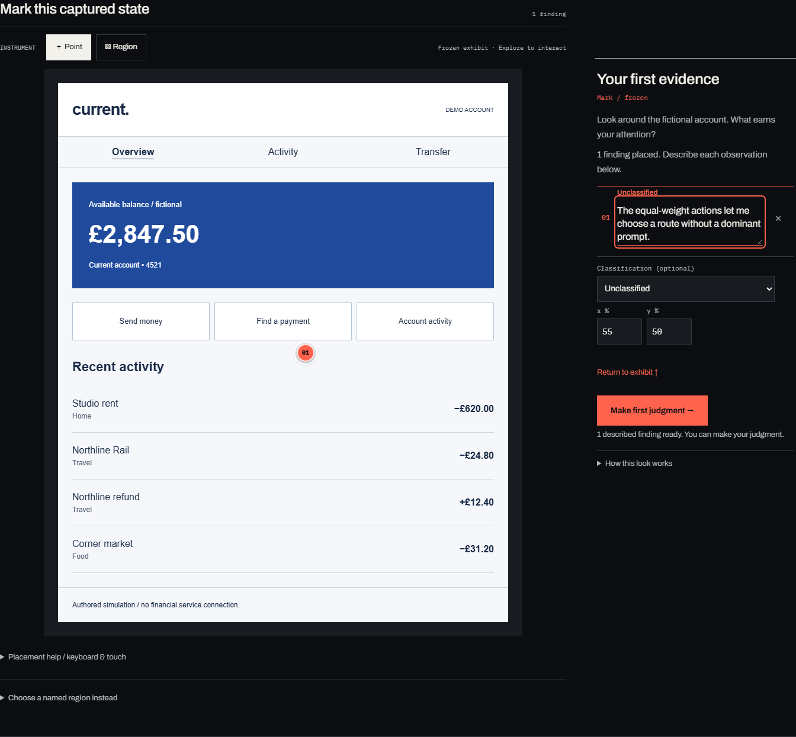
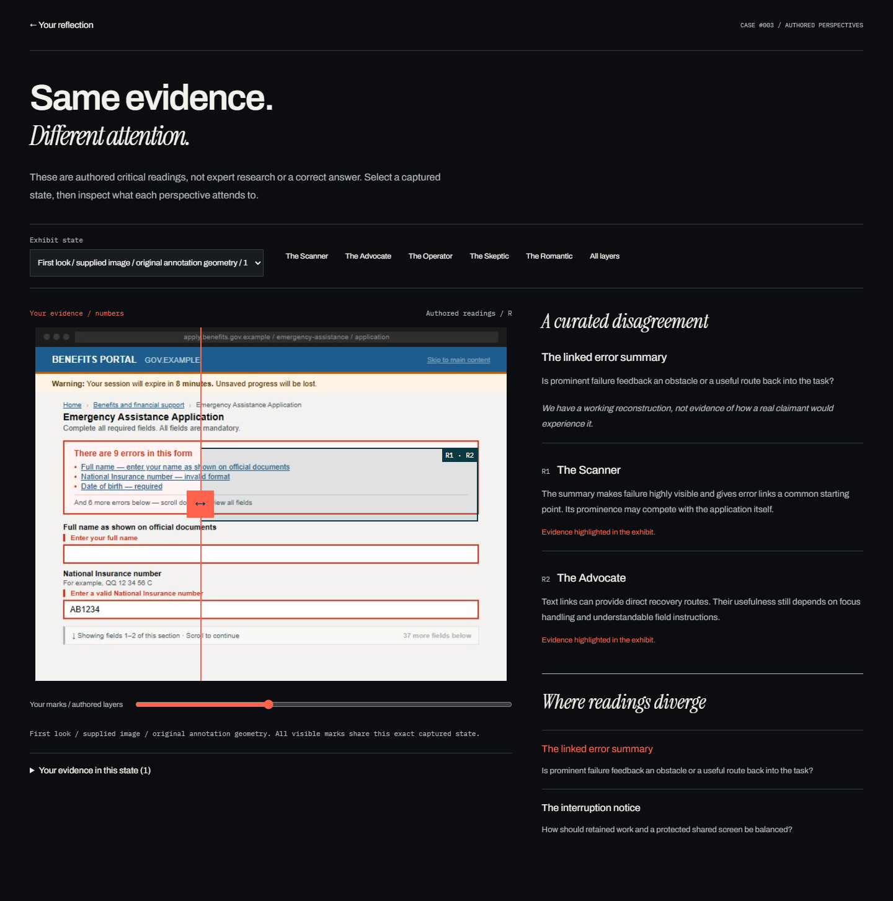
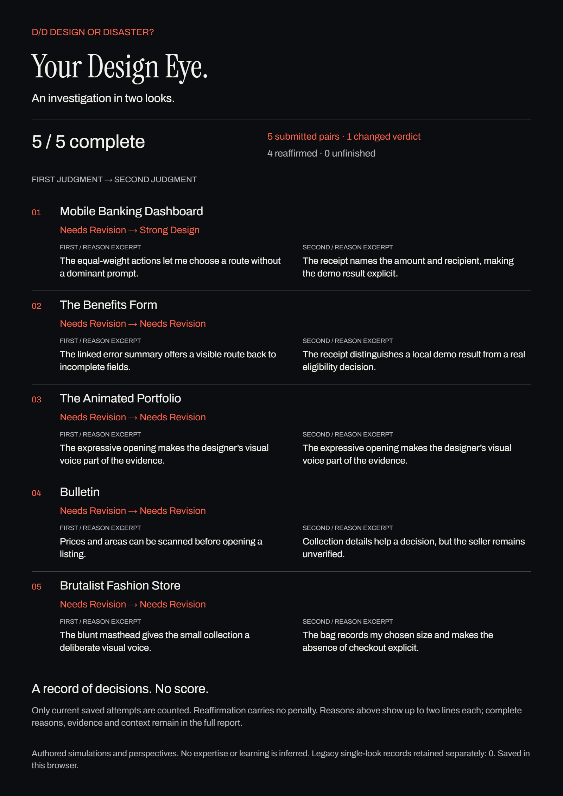
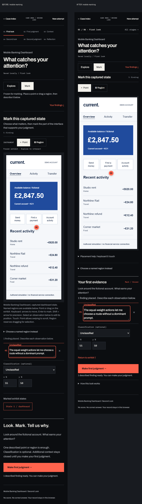

# Design or Disaster?

**What does a design judgment select as evidence before it becomes a verdict?**

An interactive design publication by Tanishk Salagame. Visitors explore five fictional interfaces, mark what matters, seal a first judgment, open context, then make an independent second call. Disagreement becomes something you can inspect.

2026 · Self-directed project · Concept, interaction and visual design, authored scenarios, critical writing and frontend engineering.

[Open the visual case study](portfolio-case-study/index.html). It works offline and uses actual application screenshots. The main portfolio website was not changed.

## The problem: a verdict hides the route to it

“Good” and “bad” compress a design judgment into a label. They leave out what the critic noticed, whose task they imagined and which uncertainty they accepted. This project asks visitors to leave an inspectable trace between an impression and a verdict. It does not claim that one interpretation is universally correct.

## What the first version could not show

The original ten-case archive paired static images with spatial notes and five authored critical positions. It made attention visible, but had four real limits:

- A still image could not demonstrate runtime behavior, such as draft recovery.
- Choosing a lens before looking could influence attention.
- Authored jurors could be mistaken for an authoritative answer.
- One final ruling could not preserve the evolution of reasoning.

These are limitations of the design, not participant findings. The archive and its short route remain available; existing records retain their original meaning.

## The breakthrough: preserve the first look

**Explore → mark evidence → seal a first judgment → open context → investigate again → seal a second judgment → reflect.**

The first judgment is an immutable snapshot. The second requires independent evidence, reason and self-reported confidence. Changing a verdict receives no reward; reaffirmation is equally valid. Different wording is recorded as different wording, never as measured learning.

## Three interactions carry the argument

### Split: one interface, two interpretations

The cover places a reading over the interface it describes. A direct handle and native range support pointer, touch and keyboard. The purpose is to introduce disagreement through a shared object. The strongest existing cover composition was preserved.

### Instrument: evidence becomes spatial

Explore operates a working exhibit; Mark freezes its state. A click used as evidence cannot also activate a payment or navigate away. Points and rectangles belong to a captured layout with logical dimensions, preserving alignment as the view scales.

This pass brings observations and geometry into the desktop inspector beside the exhibit. Selecting an existing mark focuses its numbered note. Mobile has a compact stage disclosure, optional placement help and judgment controls before optional evidence review. Keyboard, named-region and numerical alternatives remain available.

### Reveal: inspect the disagreement

Visitor marks and authored readings share an explicitly selected coordinate plane. Conflicting readings of the same region use a common boundary and numbered arguments. If a selected frame lacks a region, the interface says so. The panel offers interpretations, not a verdict to match.

## Five exhibits needed five different mechanics

| Exhibit | What a visitor can actually investigate |
| --- | --- |
| Banking | Find a refund and try a fictional transfer: calm hierarchy meets a specific task. |
| Benefits | Begin with a reconstructed still, then test validation, voluntary interruption and recovery. |
| Portfolio | Pause finite motion, inspect a project role and find contact information. |
| Bulletin | Filter dense fictional listings and shortlist an item without treating its seller as verified. |
| Fashion | Inspect a garment, choose a size and try the local bag. The sealed finale has no outside reading. |

The catalogue previews actual exhibits on desktop focus or hover. Mobile offers explicit preview expansion alongside direct entry, so visitors can compare identities without scrolling through five large images. Every working interface is authored; nothing is sent to a real service.

## Decisions and costs

**Publication and instrument.** Near-black, warm paper, signal red and the D/D slash frame exhibits with distinct visual languages. A new visual system would have weakened the relationship. Precision interactions remain immediate; no decorative motion was added.

**Spatial evidence.** A specific mark makes reasoning inspectable, but requires precise geometry and accessible alternatives. Freezing the layout protects marks from reflow; small exhibit text then behaves like image content. Named regions, notes and numerical controls offer separate routes. Physical-device magnification still needs acceptance testing.

**Local-first records.** No account or submission service is needed. The cost is that records belong to a browser profile, are unencrypted and do not automatically follow visitors across devices. Reset is deliberate; downloaded copies remain.

**Authored voices, independent closure.** Jurors make disagreement inspectable without presenting generated text as empirical expertise. The sealed finale withholds those voices. A score, winning verdict or behavioral diagnosis would undermine the proposition.

## A record worth keeping

Design Eye describes current saved decisions, explicit confidence and classifications. It distinguishes reaffirmation, changed verdicts and incomplete attempts. A new **1600 × 2263 PNG** puts all five judgment patterns on one editorial sheet, with up to two lines from each submitted reason. Excerpt limits are explicit; the full PNG and PDF remain available.

The portable text HTML edition preserves notes, judgments, confidence, opened context and reflection offline. It supplies a nonvisual alternative. Extractable PDF text does not establish accessible tagging or PDF/UA conformance.

## What this pass demonstrates

Matched Banking captures at 390px show the note-to-next-action gap falling from **608px to 251px**, and the judgment page from **2573px to 1394px**. These are layout measurements from the same synthetic task, not participant speed or satisfaction. They demonstrate less separation between interdependent actions; first-time comprehension remains open.

Automated tests, scripted browser journeys, sequential Tab journeys, axe and rendered exports supply implementation evidence. Agent-led heuristic review identified the refinements. None substitutes for participant research. Exact current results are in [the excellence handoff](PORTFOLIO-EXCELLENCE-HANDOFF.md).

## What remains unproven

No participant sessions occurred. A neutral five-person kit is ready; there are no invented quotes, success rates or learning outcomes. Actual screen-reader output, physical touch, genuine Safari and stable Firefox acceptance remain open. Available Firefox runs use the Playwright Nightly engine.

Seven earlier reconstruction origins are documented. The final review replaces three uncleared supplied captures with original fictional exhibits. Saved notes and coordinates remain unchanged, and affected legacy cases disclose that the underlying image has changed. The original captures remain uncleared and already exist in public main history; the PR does not import unpublished intermediate v2 history. Website publication remains conditional. See [provenance](IMAGE-PROVENANCE.md) and [remaining validation](REMAINING-VALIDATION.md).

AI assisted ideation, critique, writing iteration and implementation. Final concept selection, case construction, design decisions, editing and authorship remain with Tanishk Salagame. All test reasons in this presentation are synthetic. No commercial impact or independent endorsement is claimed.

## The learning

Preserving a verdict is easy. Preserving the evidence, uncertainty and competing interpretations that gave rise to it is the design work. The useful outcome is a trace another person can question, rather than a score that claims to settle the argument.
